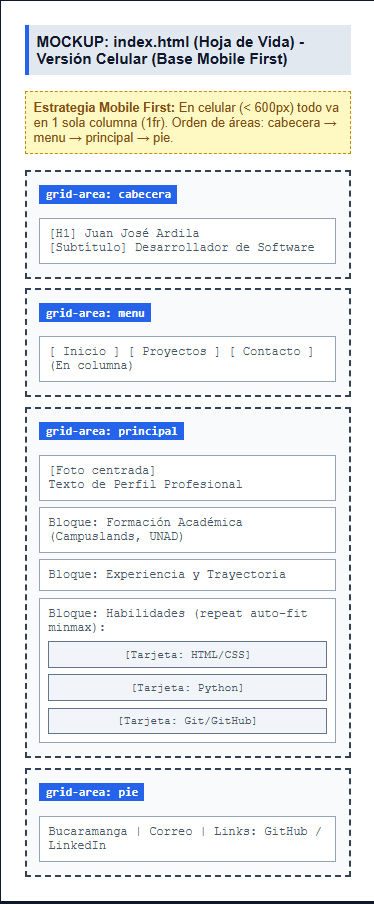
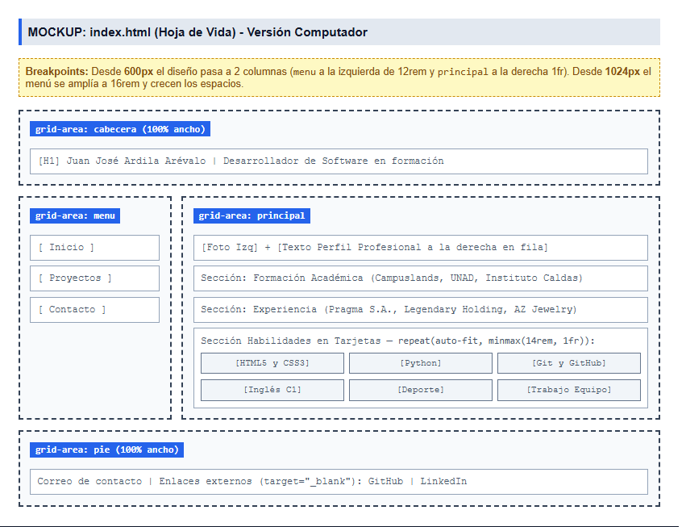
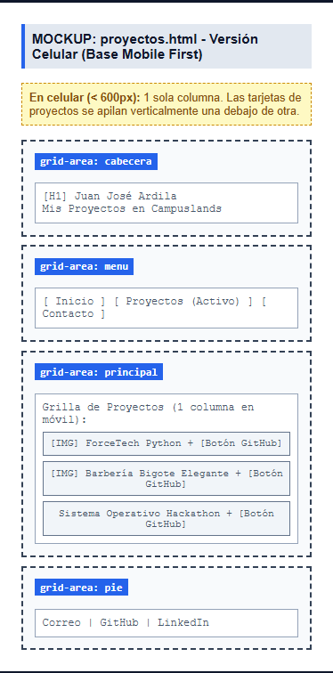
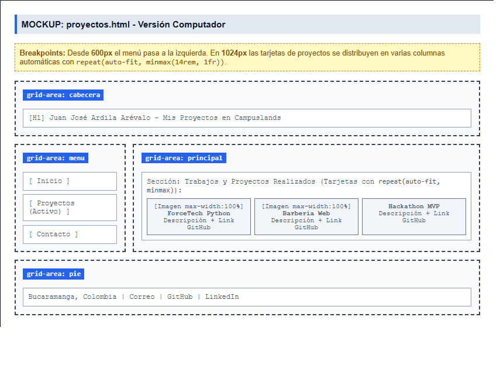
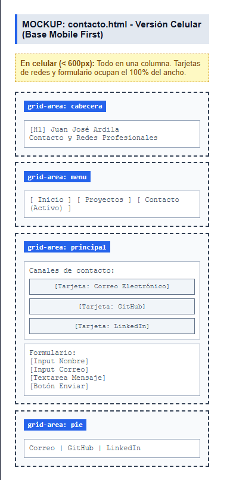
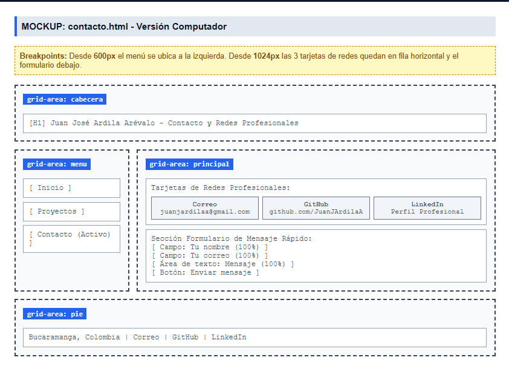
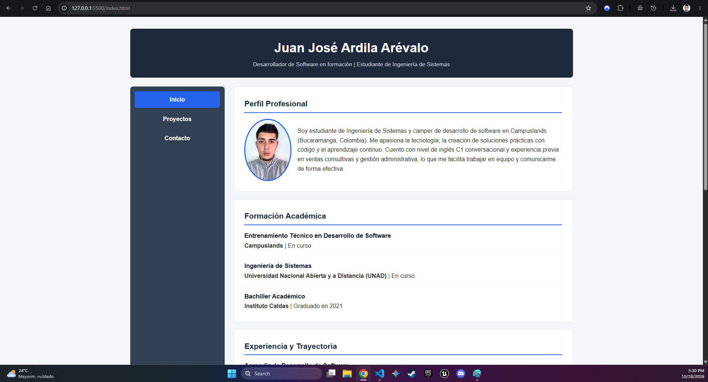

# Hoja de vida web - Juan José Ardila Arévalo

Sitio personal responsive con mi hoja de vida, mis proyectos realizados en Campuslands y mi página de contacto, construido con HTML5 y CSS3 (Grid y Mobile First).

**Sitio publicado:** https://juanjardilaa.github.io/hoja-de-vida/

## Páginas del sitio
- `index.html`: Mi hoja de vida completa (perfil profesional, formación académica, experiencia y habilidades).
- `proyectos.html`: Portafolio con los proyectos que he desarrollado en mis primeras semanas en Campuslands.
- `contacto.html`: Mis enlaces directos a GitHub, LinkedIn, correo electrónico y un formulario de contacto.

## Mockups (Fase 1)

### Hoja de vida (Inicio)

### Proyectos

### Contacto

## Capturas del sitio publicado

## Explicación de los Breakpoints (R18)
- **Base (Mobile First - Celular):** Todo el sitio se organiza en una sola columna (`1fr`) usando `grid-template-areas` con el orden vertical: `cabecera`, `menu`, `principal` y `pie`. La foto de perfil se centra encima del texto.
- **Desde 600px (`@media (min-width: 600px)`):** El layout de `grid-template-areas` cambia a 2 columnas (`12rem 1fr`). La cabecera y el pie siguen ocupando todo el ancho, pero el `menu` pasa a ubicarse como una barra lateral a la izquierda y el área `principal` queda a la derecha. Además, la foto de perfil se alinea al lado del texto descriptivo.
- **Desde 1024px (`@media (min-width: 1024px)`):** Para pantallas de computador más grandes, la columna izquierda del menú se ensancha a `16rem`, aumenta el espacio entre cajas (`gap: 1.5rem`), crece el tamaño del título principal y se amplían los márgenes internos (`padding`) para una lectura más cómoda.

## Cómo lo publiqué en GitHub Pages (R19)
1. Creé un repositorio público en mi cuenta de GitHub llamado `hoja-de-vida`.
2. Inicialicé Git en mi carpeta local (`git init`), agregué mis archivos (`git add .`), hice mis commits explicando cada avance (`git commit -m "..."`) y los subí a la rama `main` con `git push`.
3. Entré a la pestaña **Settings** (Configuración) de mi repositorio en GitHub y en el menú lateral izquierdo entré a la sección **Pages**.
4. En **Build and deployment**, debajo de *Source*, dejé seleccionada la opción *Deploy from a branch*.
5. En **Branch**, elegí la rama `main` y la carpeta `/ (root)`, y presioné el botón **Save**.
6. Esperé alrededor de 1 a 2 minutos mientras GitHub procesaba el despliegue y finalmente apareció el enlace público funcionando. *(Nota: El archivo principal se debe llamar obligatoriamente `index.html` en minúsculas porque es el archivo que los servidores web buscan por defecto al abrir la raíz de un sitio).*

## Fuentes consultadas
- Documentación oficial de GitHub Pages: [Crear un sitio de GitHub Pages](https://docs.github.com/es/pages/getting-started-with-github-pages/creating-a-github-pages-site)
- MDN Web Docs - CSS Grid Layout: [Conceptos básicos de Grid Layout](https://developer.mozilla.org/es/docs/Web/CSS/CSS_Grid_Layout)
- Validador de HTML de la W3C: [Markup Validation Service](https://validator.w3.org/)